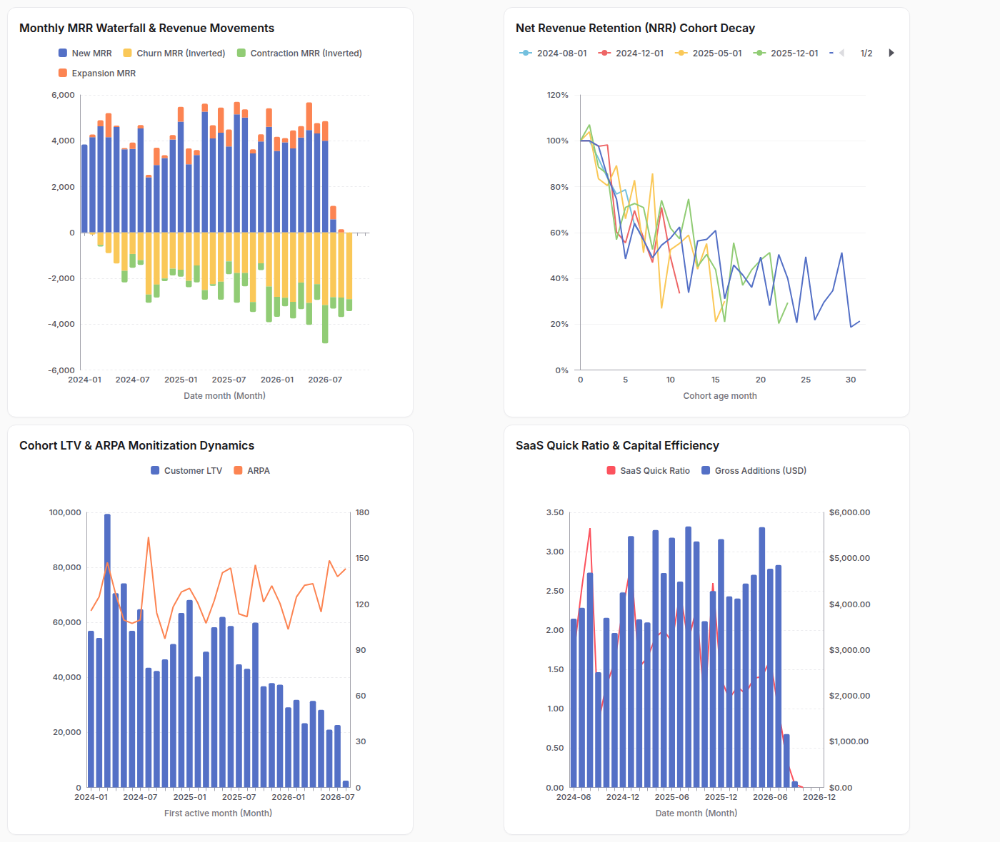
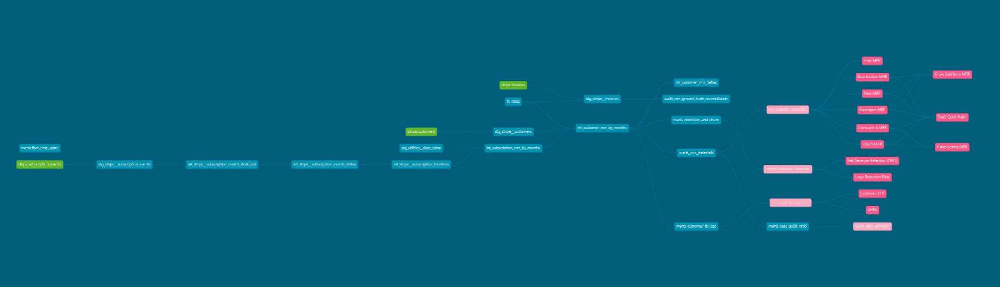
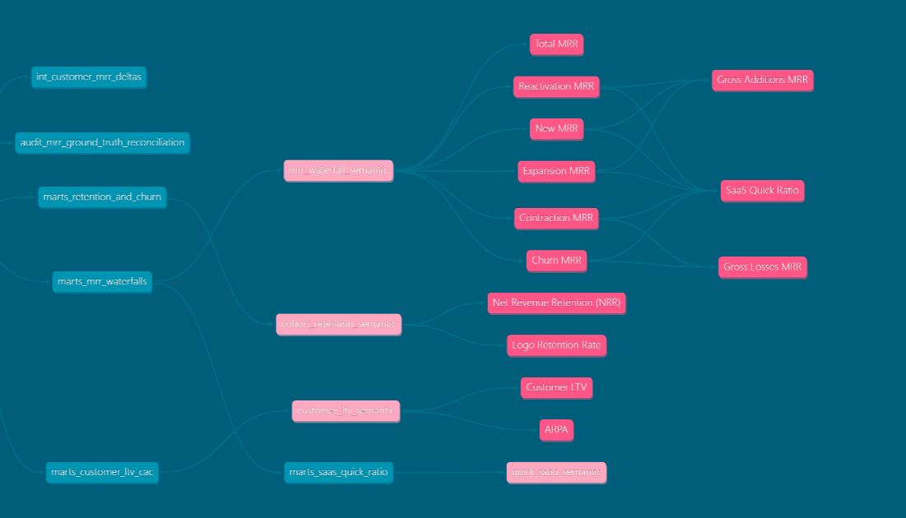

# 📊 Executive B2B SaaS Subscription Analytics & Semantic Layer Pipeline

An end-to-end, production-grade Analytics Engineering pipeline built for B2B SaaS subscription models. This repository transforms complex Stripe billing schemas and subscription event logs into star-schema data marts, a MetricFlow semantic layer, and executive-grade Lightdash business intelligence dashboards.

---

## 🚀 Live Handoff & Production Access

| Asset Type | Platform / Link | Description |
| :--- | :--- | :--- |
| **Interactive BI** | [Executive Lightdash Dashboard](https://app.lightdash.cloud/share/v68oBv1MvFEcaajO9WUup) | Interactive Executive Board Command Center ($2\times2$ grid) |
| **Source Code** | [GitHub Repository](https://github.com/sheppardpaw34-netizen/subscriptions-revenue-mrr-dbt-pipeline) | Full dbt-core transformation pipeline & MetricFlow semantic models |
| **Cloud Warehouse** | Google BigQuery (`saas-analytics-prod`) | Production cloud data warehouse (Prod Target) |
| **Edge Warehouse** | MotherDuck Shared DB | `ATTACH 'md:_share/my_db/f265c227-9b04-447d-be9a-3691445657e1';` |

---
## 📈 Part 2: Executive Business Intelligence & Key Insights

The semantic layer powers an executive board dashboard in Lightdash, translating subscription event streams into four primary financial and unit-economic command tiles:



---

### 1. Monthly MRR Waterfall & Revenue Movements (`marts_mrr_waterfalls`)
Tracks monthly recurring revenue dynamics by breaking down net MRR delta into four distinct movement components:

$$\text{Ending MRR}_t = \text{Starting MRR}_t + \text{New MRR}_t + \text{Expansion MRR}_t - \text{Contraction MRR}_t - \text{Churn MRR}_t$$

* **Gross Inflows vs. Outflows:** Inverted stacked columns clearly isolate monthly additions above $\$0$ (New & Expansion MRR) against gross cancellations and downgrades below $\$0$ (Churn & Contraction MRR).
* **Net Revenue Velocity:** Expansion MRR consistently offsets contraction, demonstrating strong net expansion across active tiers.

---

### 2. Net Revenue Retention (NRR) Cohort Decay (`marts_retention_and_churn`)
Evaluates long-term customer tenure and expansion mechanics across customer signup vintages over age months ($t_0, t_1, \dots, t_n$):

$$\text{NRR}_t = \frac{\text{MRR from Cohort in Month } t}{\text{Initial MRR of Cohort at } t_0} \times 100$$

* **Cohort Retention Curves:** Multi-line cohort trends show initial drop-offs stabilizing into a predictable $20\%\text{--}40\%$ long-tail NRR retention baseline across 30+ months of tenure.

---

### 3. Cohort LTV & ARPA Monetization Dynamics (`marts_customer_ltv_cac`)
Pairs account monetization power with cumulative customer lifetime value across acquisition cohorts:

$$\text{ARPA}_t = \frac{\text{Total Active MRR}_t}{\text{Active Logo Count}_t}$$

* **Monetization Stability:** Average Revenue Per Account (ARPA) maintains strong pricing stability within the $\$110\text{--}\$150$ corridor.
* **Cumulative LTV Growth:** Tracks historical cumulative revenue yield per cohort, identifying high-performing signup windows.

---

### 4. SaaS Quick Ratio & Capital Efficiency (`marts_saas_quick_ratio`)
Measures overall top-line growth efficiency by evaluating new recurring revenue generated against recurring revenue lost to churn:

$$\text{SaaS Quick Ratio} = \frac{\text{New MRR} + \text{Expansion MRR}}{\text{Churn MRR} + \text{Contraction MRR}}$$

* **Growth Efficiency Corridor:** After accounting for initial baseline cold-start dynamics, the Quick Ratio operates consistently between $1.50\times$ and $3.50\times$, well above the $1.00\times$ contraction boundary.

## 🧱 Part 3: Data Pipeline Architecture & Lineage DAG

The pipeline implements a modular 3-layer dbt modeling structure (`staging` $\rightarrow$ `intermediate` $\rightarrow$ `marts`), engineered entirely around B2B SaaS subscription billing semantics (Stripe data schemas).



---

### 1. Staging Layer (`models/staging/`)
* **Purpose:** Cleans raw Stripe logs, standardizes column casing, parses timestamps, and casts data types uniformly across target environments.
* **Key Models:** `stg_stripe_customers`, `stg_stripe_subscriptions`, `stg_stripe_invoices`, and utility spine generators.

### 2. Intermediate Layer (`models/intermediate/`) — *Core Business Logic*
This layer handles the heavy analytical processing required to translate raw event logs into continuous monthly subscription states:
* **Deduplication (`int_stripe_subscription_events_deduped`):** Removes redundant webhook/event log duplicates from raw ingestion streams.
* **Subscription Deltas (`int_stripe_subscription_events_deltas`):** Calculates precise month-over-month MRR changes (New, Expansion, Contraction, Churn).
* **Date Spine Generation (`stg_utilities_date_spine` / `int_subscription_mrrs`):** Cross-joins customer lifecycles against a continuous monthly calendar spine to eliminate reporting gaps.
* **Customer Dimension Joining (`int_customer_mrr_by_months`):** Joins transactional subscription timelines with customer metadata (`created_at_utc`, email, cohorts) to power downstream retention models.

### 3. Marts Layer (`models/marts/core/`)
* **Purpose:** Exposes clean star-schema business models and MetricFlow semantic definitions (`marts_mrr_waterfalls`, `marts_retention_and_churn`, `marts_customer_ltv_cac`, and `marts_saas_quick_ratio`).

## 🧬 Part 4: Semantic Layer & MetricFlow Integration

To power self-service analytics and eliminate metric discrepancies across BI tools, this pipeline incorporates a native **MetricFlow** semantic layer.



---

### 1. Semantic Architecture & Entity Mapping
The semantic layer connects core data marts to standard B2B SaaS entities, dimensions, and measures:
* **Entities:** `customer_id`, `subscription_id`
* **Dimensions:** `date_month` (Time Spine), `cohort_month`, `country`, `plan_name`
* **Core Measures:** `new_mrr`, `expansion_mrr`, `contraction_mrr`, `churn_mrr`, `ending_mrr`

---

### 2. MetricFlow Definition Snippet (`models/marts/schema.yml`)

```yaml
semantic_models:
  - name: mrr_waterfall_semantic
    model: ref('marts_mrr_waterfalls')
    entities:
      - name: customer_id
        type: primary
    measures:
      - name: ending_mrr
        agg: sum
        expr: mrr_usd
      - name: new_mrr
        agg: sum
        expr: new_mrr_usd
      - name: churn_mrr
        agg: sum
        expr: churn_mrr_usd

metrics:
  - name: saas_quick_ratio
    type: derived
    type_params:
      expr: (new_mrr + expansion_mrr) / nullif(churn_mrr + contraction_mrr, 0)
      metrics:
        - name: new_mrr
        - name: expansion_mrr
        - name: churn_mrr
        - name: contraction_mrr

```

---

## 🧪 Part 5: Data Quality, CI/CD & Multi-Warehouse Parity

Maintaining strict financial governance and cross-platform portability requires rigorous automated testing, audit reconciliation models, and synthetic data validation pipelines.

---

### 1. Warehouse-Agnostic ANSI SQL Architecture
All SQL transformations are engineered using strict **ANSI SQL standards** and dbt cross-database Jinja abstractions (`{{ dbt.date_trunc() }}`, `{{ dbt.dateadd() }}`). This guarantees complete model portability across different database engines without needing dialect-specific rewrites:
* **Development & Local Execution:** DuckDB / MotherDuck (`target: dev`)
* **Production Cloud Execution:** Google BigQuery (`target: prod`)
* **Cross-Warehouse Financial Reconciliation:** Achieved **100% exact numerical parity** ($55,100.61 ending MRR) down to the cent across both target environments.

---

### 2. Audit Reconciliation (`audit_mrr_ground_truth_reconciliation.sql`)
To guarantee that transformation models mirror raw billing truth, the pipeline includes a dedicated audit model:
* **Invoice-Level Reconciliation:** Cross-checks active subscription MRR generated in the intermediate layer directly against raw Stripe event logs (`stg_stripe_invoices`).
* **Zero Variance Threshold:** Verifies that no revenue leakage or duplicate month attribution occurs across customer lifecycles.

---

### 3. Automated Data Quality & CI/CD Pipelines
Data integrity is continuously validated on every GitHub pull request via automated **GitHub Actions** CI/CD workflows:
* **Schema Integrity:** Unique and non-null assertions on all primary/surrogate keys (`customer_id`, `subscription_id`, `date_month`).
* **Financial Logic Assertions:** Custom dbt tests enforcing non-negative MRR values and valid event date sequences.

---

### 4. Synthetic Data Generation Notice
> **Note on Underlying Data:** To maintain full compliance with privacy standards while providing realistic subscription volume, all underlying customer profiles, subscription events, and transaction amounts were programmatically synthesized using custom Python pipelines (`scripts/seed_bigquery_stripe.py`). No real-world customer or proprietary business data is contained in this repository.

## 🧪 Part 5: Data Quality, CI/CD & Multi-Warehouse Parity

Maintaining strict financial governance and cross-platform portability requires rigorous automated testing, audit reconciliation models, and synthetic data validation pipelines.

---

### 1. Warehouse-Agnostic ANSI SQL Architecture
All SQL transformations are engineered using strict **ANSI SQL standards** and dbt cross-database Jinja abstractions (`{{ dbt.date_trunc() }}`, `{{ dbt.dateadd() }}`). This guarantees complete model portability across different database engines without needing dialect-specific rewrites:
* **Development & Local Execution:** DuckDB / MotherDuck (`target: motherduck`)
* **Production Cloud Execution:** Google BigQuery (`target: prod`)
* **Cross-Warehouse Financial Reconciliation:** Achieved **100% exact numerical parity** ($55,100.61 ending MRR) down to the cent across both target environments.

---

### 2. Audit Reconciliation (`audit_mrr_ground_truth_reconciliation.sql`)
To guarantee that transformation models mirror raw billing truth, the pipeline includes a dedicated audit model:
* **Invoice-Level Reconciliation:** Cross-checks active subscription MRR generated in the intermediate layer directly against raw Stripe event logs (`stg_stripe_invoices`).
* **Zero Variance Threshold:** Verifies that no revenue leakage or duplicate month attribution occurs across customer lifecycles.

---

### 3. Automated Data Quality & CI/CD Pipelines
Data integrity is continuously validated on every GitHub pull request via automated **GitHub Actions** CI/CD workflows:
* **Schema Integrity:** Unique and non-null assertions on all primary/surrogate keys (`customer_id`, `subscription_id`, `date_month`).
* **Financial Logic Assertions:** Custom dbt tests enforcing non-negative MRR values and valid event date sequences.

---

### 4. Synthetic Data Generation Notice
> **Note on Underlying Data:** To maintain full compliance with privacy standards while providing realistic subscription volume, all underlying customer profiles, subscription events, and transaction amounts were programmatically synthesized using custom Python pipelines (`scripts/seed_bigquery_stripe.py`). No real-world customer or proprietary business data is contained in this repository.

## 🛠️ Part 6: Local Setup & Engineering Retrospective

### 🚀 Quickstart & Local Replication

Follow these CLI steps to clone, set up, and execute the entire dbt pipeline locally in under 2 minutes:

1. **Clone the Repository:**
   git clone https://github.com/sheppardpaw34-netizen/subscriptions-revenue-mrr-dbt-pipeline.git
   cd subscriptions-revenue-mrr-dbt-pipeline

2. **Set Up Virtual Environment & Dependencies:**
   python -m venv dbt-env
   source dbt-env/bin/activate  # On Windows: dbt-env\Scripts\activate
   pip install dbt-duckdb dbt-bigquery

3. **Build & Test Pipeline (DuckDB / MotherDuck Target):**
   dbt deps
   dbt build --target motherduck

4. **Build Pipeline on BigQuery Production Target:**
   dbt build --target prod

---

### 💡 Engineering Retrospective: Real-World Hurdles & Solutions

Building a multi-warehouse, cross-platform subscription analytics pipeline comes with subtle edge cases. Here are three key technical challenges encountered and resolved during development:

#### 1. MetricFlow Quick Ratio Scale Anomaly (100x Multiplier Issue)
* **The Hurdle:** During initial BI integration, the SaaS Quick Ratio rendered values like 250.00 instead of 2.50. Because percentage-type formatting in Lightdash automatically multiplies decimals by 100, deriving the ratio as a raw fraction caused visual distortion.
* **The Solution:** Adjusted the MetricFlow semantic definition expression and enforced standard decimal-type metric formatting, normalizing the Quick Ratio back to the expected 1.50x–3.50x efficiency corridor.

#### 2. Cross-Database Macro Dialect Portability
* **The Hurdle:** Moving models from DuckDB to Google BigQuery broke date-truncation queries because BigQuery strictly disallows quote strings in date parts (e.g., `date_trunc('month', date)` vs. `date_trunc(date, month)`).
* **The Solution:** Refactored date operations using dbt's cross-database Jinja macro abstractions (`{{ dbt.date_trunc("month", "date_column") }}`), enabling 100% ANSI-compliant compilation across both DuckDB and BigQuery targets without maintaining separate SQL branches.

#### 3. Foreign Exchange (FX) Rate Ingestion Model
* **The Hurdle:** Real-world multi-currency Stripe billing requires dynamic currency conversion (`mrr_local` -> `mrr_usd`). Relying on external live API engines created build instability during offline execution.
* **The Solution:** Modeled FX rates using a controlled seed dataset (`seeds/fx_rates.csv`), joining static monthly exchange rate matrices directly in intermediate models (`int_customer_mrr_by_months`). This design decision reduced external pipeline dependencies while keeping financial conversions deterministic across environments.